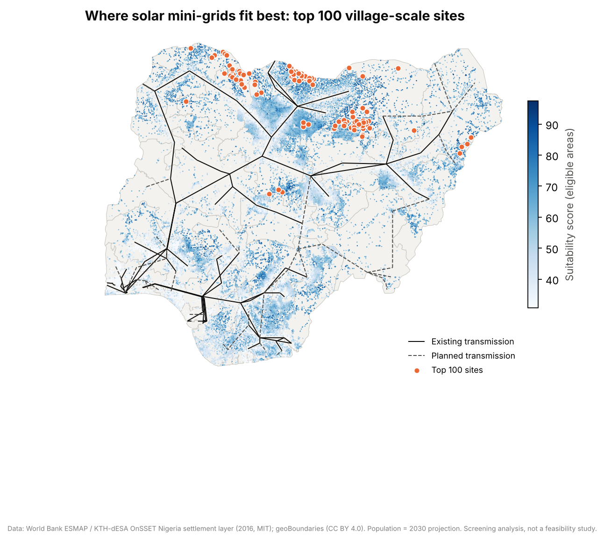
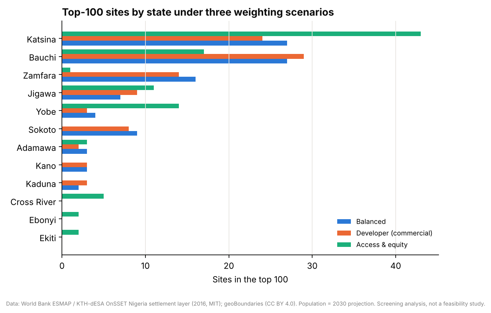
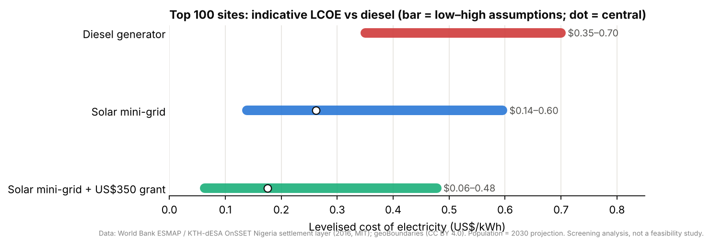
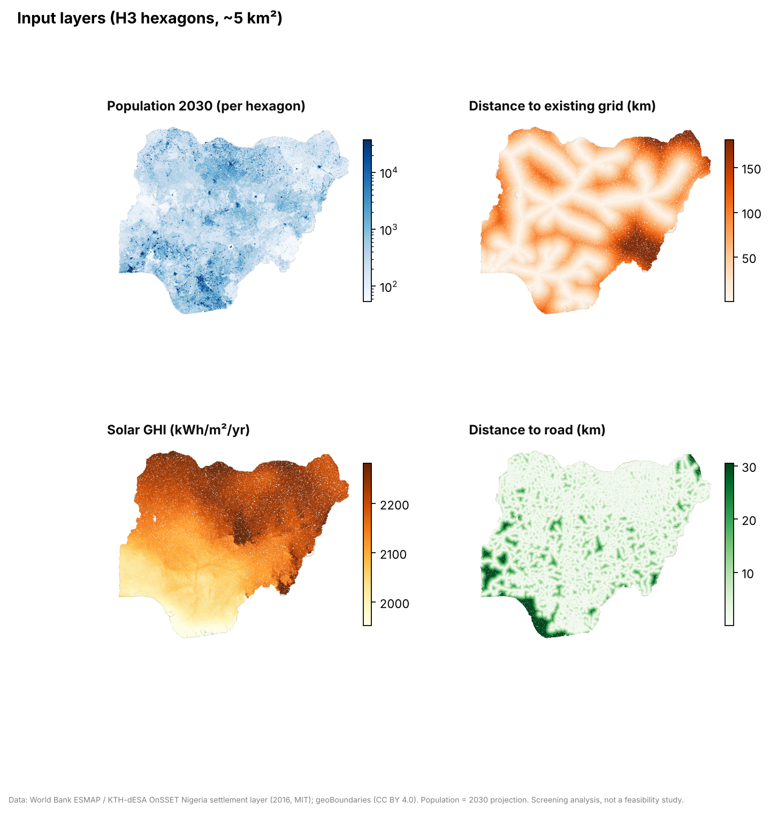
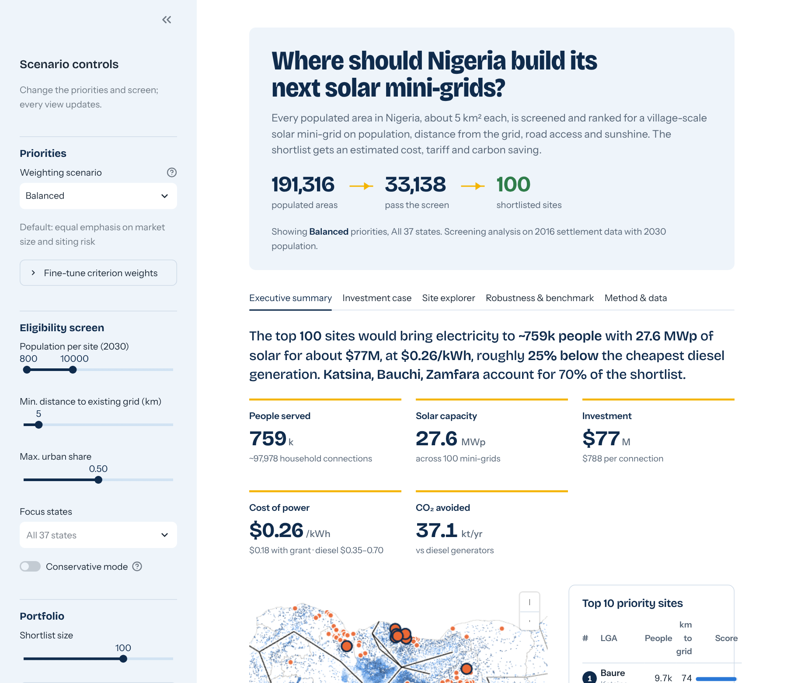
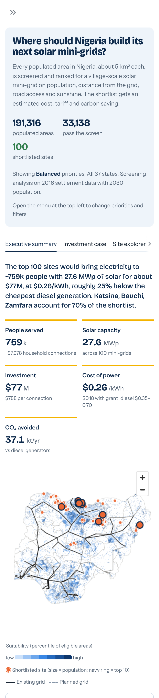

# ☀️ Solar Mini-Grid Site Suitability: Nigeria

[](https://github.com/Engr-Daniel/solar-minigrid-site-suitability-nigeria/actions/workflows/tests.yml)
 

🌐 **[Project website](https://engr-daniel.github.io/solar-minigrid-site-suitability-nigeria/)** · 📊 **[Live dashboard](https://solar-minigrid-site-suitability-nigeria.streamlit.app/)** · 📓 [Analysis notebook](notebooks/01_site_suitability.ipynb) · 📐 [Methodology](docs/methodology.md)

**Where should Nigeria build its next solar mini-grids?** This project ranks **191,316 populated hexagons (~5 km² each)** for village-scale solar mini-grids. It uses multi-criteria decision analysis (MCDA) on population, distance to the grid, road access and solar resource, then tests how robust the ranking is and estimates site economics.

> ⚠️ **Screening analysis.** Settlement, grid and road layers come from the 2016 World Bank ESMAP / KTH OnSSET model, and population is a 2030 projection. Shortlisted sites need field verification of current grid status and demand.



## 📊 Key findings (Balanced weights, top 100 sites)
| Result | Value |
|---|---|
| Eligible village-scale areas (800–10,000 people, rural, ≥5 km from grid) | **33,138 hexagons** |
| Top 100 sites would serve | **~759,000 people · ~98,000 connections** |
| Solar PV required / indicative capex | **27.6 MWp · ~$77M** (~$790 per connection) |
| Indicative LCOE | **$0.26/kWh** (range $0.14–0.60) vs **$0.35–0.70** for diesel gensets; **$0.18** with a $350/connection grant |
| CO₂ avoided vs diesel | **~37 kt/yr** |
| Where | **Katsina, Bauchi, Zamfara** hold 70%: compact villages a median 69 km from the grid |
| Robustness | 60% of sites stay in the top 100 in ≥80% of 1,000 random weight sets; Balanced and Developer scenarios share 85/100 sites |

- **The north is the sweet spot.** The highest solar resource (~2,240 kWh/m²/yr) coincides with dense villages far from the transmission network.
- **Solar beats diesel at screening level.** The central LCOE is about 25–60% below diesel generation, even before grants.
- **Weights matter at the margin, not the core.** The commercial and balanced lenses agree on most sites. An *Access & equity* lens pulls in Yobe, Cross River and Ebonyi.
- **The 2016 least-cost model disagrees, and that's expected.** OnSSET-2016 chose grid extension for every shortlisted site, because 2016 PV and battery costs made solar mini-grids least-cost for only ~0.1% of the population. Newer modelling ([SEforALL Nigeria IEP, 2022](https://www.seforall.org/Nigeria_IEPT-Electrification_Report)) finds mini-grids least-cost in denser settlements far from the grid. A **conservative shortlist** of sites both models agree on (smaller villages in Borno, Yobe and Adamawa) is included.

<p float="left">
  
  
</p>

## 🧭 Method
1. **Ingest** (`src/minigrid/ingest.py`): a sparse git fetch of the World Bank/KTH OnSSET Nigeria layer (934,595 × 1 km² cells), transmission lines (TopoJSON decoded) and geoBoundaries.
2. **Aggregate** (`hexes.py`): cells become **H3 resolution-7 hexagons**, with state and LGA attached by spatial join.
3. **Screen + score** (`mcda.py`): an eligibility screen, then **7 criteria** normalised 0–1 (demand saturating at 4,000 people, compactness, distance to existing grid, distance to future grid, solar, road access, optional poverty), combined by weighted linear combination into a score of 0–100.
4. **Robustness:** a Dirichlet Monte Carlo over the weights reports how often each site stays in the top N.
5. **Shortlist:** greedy by rank, no two neighbouring hexagons.
6. **Economics** (`economics.py`): demand (MTF Tier 3 + productive use), PV sizing from GHI, capex, LCOE (with and without grant), and CO₂ avoided using DESNZ 2026 diesel factors.
7. **Benchmark:** agreement with OnSSET-2016's least-cost technology.

Full details: [docs/methodology.md](docs/methodology.md).



## 🖥️ Dashboard
**[Open the live dashboard →](https://solar-minigrid-site-suitability-nigeria.streamlit.app/)** It's built as a stakeholder presentation and works on desktop and mobile:
- **Executive summary:** headline, KPIs, suitability map, top 10 sites, key findings and recommended next steps
- **Investment case:** solar vs diesel cost, people reached per dollar, phased roll-out tranches, investment by state
- **Site explorer:** ranked shortlist (click a row) → site profile, criterion scores, site facts and local map
- **Robustness & benchmark:** weight Monte Carlo, agreement between stakeholder lenses, OnSSET-2016 comparison
- **Briefing note:** a one-click printable HTML brief (print to PDF) for the current scenario

<p float="left">
  
  
</p>

## 🗂️ Structure
```
├── app/streamlit_app.py            # Interactive dashboard (pydeck H3 map)
├── data/
│   ├── processed/                  # hexes.parquet (191k H3 hexagons), states, transmission lines
│   └── reference/                  # criteria.csv, weight_scenarios.csv, economic_assumptions.csv
├── docs/methodology.md
├── notebooks/01_site_suitability.ipynb
├── reports/figures/
├── src/minigrid/                   # ingest, hexes, mcda, economics, figures
├── tests/                          # pytest (CI)
├── AGENTS.md · MEMORY.md · TASK.md
├── requirements.txt                # dashboard runtime (Streamlit Cloud)
└── requirements-dev.txt            # pipeline, figures, notebooks, tests
```

## 🚀 Getting started
```bash
git clone https://github.com/Engr-Daniel/solar-minigrid-site-suitability-nigeria.git
cd solar-minigrid-site-suitability-nigeria
pip install -r requirements-dev.txt
streamlit run app/streamlit_app.py            # dashboard (uses committed data/processed)
pytest -q                                     # tests
# Rebuild everything from source:
python src/minigrid/ingest.py && python src/minigrid/hexes.py && python src/minigrid/figures.py
```

## 📚 Sources
- World Bank ESMAP & KTH-dESA: [Electrification pathways for Nigeria, Tanzania and Zambia](https://github.com/energy-data/nzt-electrification) (OnSSET, MIT licence) · Mentis et al. (2015), *A GIS-based approach for electrification planning: a case study on Nigeria*
- [geoBoundaries](https://www.geoboundaries.org/) NGA ADM1/ADM2 (CC BY 4.0)
- ESMAP (2019), *Mini Grids for Half a Billion People*: typical mini-grid 800–4,000 people; US$500–2,100 per connection
- SEforALL / REA (2022), [Nigeria Integrated Energy Plan: geospatial electrification model](https://www.seforall.org/Nigeria_IEPT-Electrification_Report): diesel LCOE $0.35–0.70/kWh; $350/connection subsidy
- World Bank Multi-Tier Framework (Tier 3 ≥ 365 kWh/household/yr) · NBS Nigeria Living Standards Survey 2020 (rural household size 5.42)
- UK DESNZ 2026 GHG conversion factors (diesel 2.66155 kgCO₂e/L)

## 👤 Author
**Daniel Oyewale**, data analyst, data strategist and sustainability researcher. Companion project: [Carbon Footprint & ESG Dashboard](https://github.com/Engr-Daniel/carbon-footprint-esg-dashboard).
